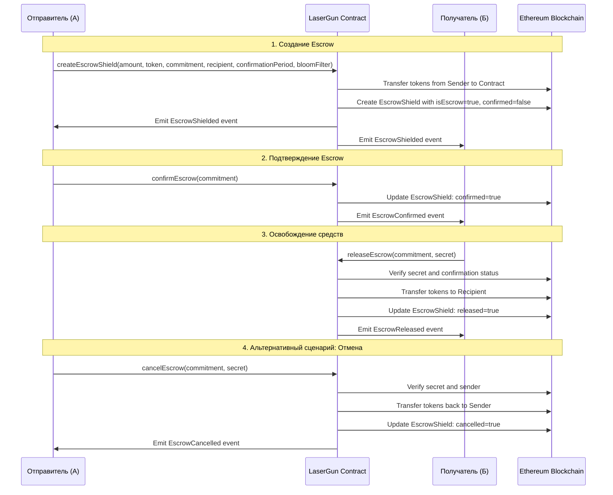
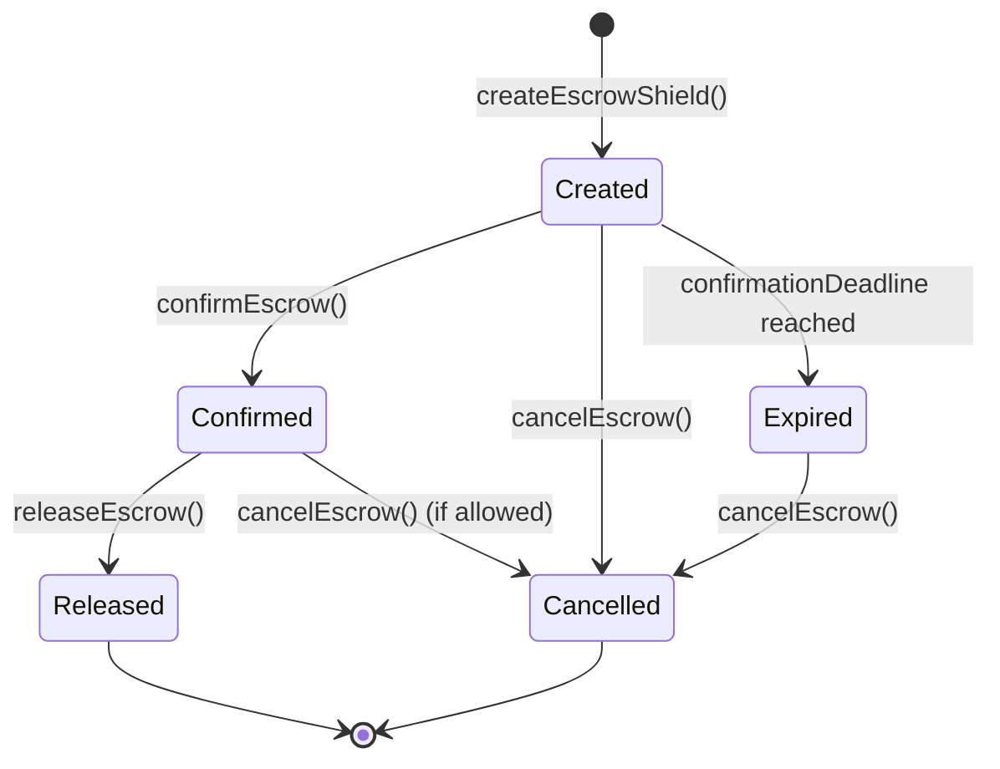

# Детальный проект механизма Escrow для Shielded расписок

## Обзор

На основе анализа контракта LaserGun.sol, данный документ определяет архитектуру и реализацию механизма escrow для shielded расписок. Механизм позволяет безопасно блокировать токены в escrow до подтверждения отправителем, после чего они освобождаются получателю.

## 1. Расширение структуры Shield

### 1.1 Новая структура EscrowShield

```solidity
/**
 * @notice EscrowShield structure for storing private tokens in escrow
 * @dev Extends Shield with escrow-specific fields
 * @param token Address of the ERC20 token
 * @param amount Amount of tokens in the shield
 * @param timestamp Shield creation time
 * @param exists Flag indicating if shield exists
 * @param spent Flag indicating if shield is spent
 * @param isEscrow Flag indicating if this is an escrow shield
 * @param sender Address of the sender who created the escrow
 * @param recipient Address of the intended recipient
 * @param confirmationDeadline Timestamp until when sender must confirm
 * @param confirmed Flag indicating if escrow has been confirmed by sender
 * @param released Flag indicating if funds have been released to recipient
 * @param cancelled Flag indicating if escrow was cancelled
 */
struct EscrowShield {
    address token;
    uint256 amount;
    uint256 timestamp;
    bool exists;
    bool spent;
    bool isEscrow;
    address sender;
    address recipient;
    uint256 confirmationDeadline;
    bool confirmed;
    bool released;
    bool cancelled;
}
```

### 1.2 Обоснование полей

- `isEscrow`: Флаг для идентификации escrow-щитов, позволяет различать обычные и escrow-щиты
- `sender`: Адрес отправителя, необходим для проверки прав подтверждения/отмены
- `recipient`: Адрес получателя, для whom предназначены средства
- `confirmationDeadline`: Временное ограничение для подтверждения, предотвращает бесконечную блокировку средств
- `confirmed`: Флаг подтверждения отправителем, активирует возможность освобождения средств
- `released`: Флаг освобождения средств получателю, предотвращает повторное освобождение
- `cancelled`: Флаг отмены escrow, позволяет вернуть средства отправителю

### 1.3 Модификация существующей структуры Shield

Для обратной совместимости мы не будем изменять существующую структуру Shield, а создадим отдельную структуру EscrowShield и новый маппинг:

```solidity
/// @notice Mapping of commitment hashes to escrow shield data
mapping(bytes32 => EscrowShield) public escrowShields;
```

## 2. Новые функции

### 2.1 createEscrowShield()

```solidity
/**
 * @notice Create an escrow shield for confidential token storage with confirmation requirement
 * @param amount Amount of tokens to deposit
 * @param token Address of the ERC20 token
 * @param commitment Unique commitment generated from secret
 * @param recipient Address of the intended recipient
 * @param confirmationPeriod Time period (in seconds) for sender confirmation
 * @param bloomFilter Bloom filter for privacy
 *
 * Requirements:
 * - amount > 0
 * - token must be a valid ERC20 contract
 * - commitment must not exist previously
 * - recipient must be a valid address
 * - confirmationPeriod must be reasonable (e.g., between 1 hour and 30 days)
 * - User must approve token transfer
 *
 * Effects:
 * - Tokens are transferred to the contract address
 * - A new escrow shield is created with the specified amount minus fee
 * - Fee is credited to collectedFees
 * - EscrowShielded event is emitted
 */
function createEscrowShield(
    uint256 amount,
    address token,
    bytes32 commitment,
    address recipient,
    uint256 confirmationPeriod,
    bytes32 bloomFilter
) external nonReentrant whenNotPaused;
```

### 2.2 confirmEscrow()

```solidity
/**
 * @notice Confirm an escrow shield by the sender
 * @param commitment Commitment of the escrow shield to confirm
 *
 * Requirements:
 * - Caller must be the sender of the escrow
 * - Escrow must exist and not be confirmed, released or cancelled
 * - Current time must be before confirmationDeadline
 *
 * Effects:
 * - Marks escrow as confirmed
 * - Emits EscrowConfirmed event
 */
function confirmEscrow(bytes32 commitment) external nonReentrant whenNotPaused;
```

### 2.3 releaseEscrow()

```solidity
/**
 * @notice Release confirmed escrow funds to recipient
 * @param commitment Commitment of the escrow shield to release
 * @param secret Secret corresponding to the escrow shield commitment
 *
 * Requirements:
 * - Escrow must exist and be confirmed
 * - Escrow must not be released or cancelled
 * - Secret must correspond to the escrow shield commitment
 *
 * Effects:
 * - Transfers tokens to recipient
 * - Marks escrow as released
 * - Emits EscrowReleased event
 */
function releaseEscrow(bytes32 commitment, bytes32 secret) external nonReentrant whenNotPaused;
```

### 2.4 cancelEscrow()

```solidity
/**
 * @notice Cancel an escrow and return funds to sender
 * @param commitment Commitment of the escrow shield to cancel
 * @param secret Secret corresponding to the escrow shield commitment
 *
 * Requirements:
 * - Caller must be the sender of the escrow
 * - Escrow must exist and not be confirmed, released or cancelled
 * - Secret must correspond to the escrow shield commitment
 * - Current time must be after confirmationDeadline OR escrow is not confirmed
 *
 * Effects:
 * - Transfers tokens back to sender
 * - Marks escrow as cancelled
 * - Emits EscrowCancelled event
 */
function cancelEscrow(bytes32 commitment, bytes32 secret) external nonReentrant whenNotPaused;
```

## 3. Модификация существующих функций

### 3.1 Изменения в функции unshield()

```solidity
// Добавить проверку на escrow-статус перед unshield
function unshield(
    bytes32 secret,
    uint256 redeemAmount,
    address recipient,
    bytes32 newCommitment
) external nonReentrant whenNotPaused {
    // Существующие проверки...
    
    // Новая проверка: убедиться, что это не escrow shield
    bytes32 commitment = this.generateCommitment(secret, msg.sender);
    if (escrowShields[commitment].isEscrow) {
        revert CannotUnshieldEscrowDirectly();
    }
    
    // Остальной код функции...
}
```

### 3.2 Изменения в функции transfer()

```solidity
// Добавить проверку на escrow-статус перед transfer
function transfer(
    bytes32 secret,
    uint256 amount,
    bytes32 recipientCommitment,
    bytes calldata encryptedSecret,
    bytes32 bloomFilter
) external nonReentrant whenNotPaused {
    // Существующие проверки...
    
    // Новая проверка: убедиться, что это не escrow shield
    bytes32 senderCommitment = this.generateCommitment(secret, msg.sender);
    if (escrowShields[senderCommitment].isEscrow) {
        revert CannotTransferEscrowDirectly();
    }
    
    // Остальной код функции...
}
```

### 3.3 Новые view-функции

```solidity
/**
 * @notice Get escrow shield information
 * @param commitment Escrow shield commitment
 * @return escrowShield Complete escrow shield data
 */
function getEscrowShieldInfo(bytes32 commitment) external view returns (EscrowShield memory escrowShield);

/**
 * @notice Check if commitment is an active escrow
 * @param commitment Commitment to check
 * @return true if commitment is an active escrow
 */
function isActiveEscrow(bytes32 commitment) external view returns (bool);

/**
 * @notice Get escrow status
 * @param commitment Escrow commitment
 * @return status Current status of the escrow (Pending, Confirmed, Released, Cancelled, Expired)
 */
function getEscrowStatus(bytes32 commitment) external view returns (string memory status);
```

## 4. События

### 4.1 Новые события

```solidity
/**
 * @notice Event emitted when an escrow shield is created
 * @param commitment Unique identifier of the escrow shield
 * @param token Address of the token
 * @param amount Amount of tokens in the escrow
 * @param sender Address of the sender
 * @param recipient Address of the recipient
 * @param confirmationDeadline Timestamp until when sender must confirm
 * @param fee Operation fee
 * @param bloomFilter Bloom filter for privacy
 */
event EscrowShielded(
    bytes32 indexed commitment,
    address indexed token,
    uint256 amount,
    address indexed sender,
    address recipient,
    uint256 confirmationDeadline,
    uint256 fee,
    bytes32 bloomFilter
);

/**
 * @notice Event emitted when an escrow is confirmed by sender
 * @param commitment Identifier of the escrow shield
 * @param sender Address of the sender who confirmed
 */
event EscrowConfirmed(bytes32 indexed commitment, address indexed sender);

/**
 * @notice Event emitted when escrow funds are released to recipient
 * @param commitment Identifier of the escrow shield
 * @param recipient Address of the recipient
 * @param amount Amount of tokens released
 */
event EscrowReleased(bytes32 indexed commitment, address indexed recipient, uint256 amount);

/**
 * @notice Event emitted when an escrow is cancelled
 * @param commitment Identifier of the escrow shield
 * @param sender Address of the sender who cancelled
 * @param amount Amount of tokens returned
 */
event EscrowCancelled(bytes32 indexed commitment, address indexed sender, uint256 amount);

/**
 * @notice Event emitted when an escrow expires
 * @param commitment Identifier of the escrow shield
 * @param sender Address of the sender
 * @param amount Amount of tokens that can be refunded
 */
event EscrowExpired(bytes32 indexed commitment, address indexed sender, uint256 amount);
```

## 5. Диаграмма процесса

### 5.1 Последовательность операций при создании и выполнении escrow



### 5.2 Диаграмма состояний Escrow



## 6. Безопасность

### 6.1 Меры безопасности

1. **Проверка прав доступа**:
   - Только отправитель может подтвердить или отменить escrow
   - Только получатель может освободить подтвержденные средства
   - Проверка соответствия секрета для всех операций

2. **Временные ограничения**:
   - Максимальный период подтверждения (например, 30 дней)
   - Минимальный период подтверждения (например, 1 час)
   - Автоматическая возможность отмены после истечения срока

3. **Защита от реентеранса**:
   - Использование модификатора nonReentrant
   - Обновление состояния перед внешними вызовами

4. **Проверки состояния**:
   - Проверка каждого состояния escrow перед операцией
   - Предотвращение повторных операций

5. **Защита от атак**:
   - Проверка на нулевые адреса
   - Проверка на переполнение при расчетах
   - Ограничение на минимальную сумму для предотвращения dust атак

### 6.2 Новые ошибки

```solidity
/**
 * @dev Error thrown when trying to unshield an escrow shield directly
 */
error CannotUnshieldEscrowDirectly();

/**
 * @dev Error thrown when trying to transfer an escrow shield directly
 */
error CannotTransferEscrowDirectly();

/**
 * @dev Error thrown when escrow is not in the expected state
 */
error InvalidEscrowState();

/**
 * @dev Error thrown when caller is not the escrow sender
 */
error NotEscrowSender();

/**
 * @dev Error thrown when caller is not the escrow recipient
 */
error NotEscrowRecipient();

/**
 * @dev Error thrown when confirmation period is invalid
 */
error InvalidConfirmationPeriod();

/**
 * @dev Error thrown when escrow confirmation deadline has passed
 */
error ConfirmationDeadlinePassed();

/**
 * @dev Error thrown when escrow is not yet confirmed
 */
error EscrowNotConfirmed();

/**
 * @dev Error thrown when escrow is already confirmed
 */
error EscrowAlreadyConfirmed();

/**
 * @dev Error thrown when escrow is already released
 */
error EscrowAlreadyReleased();

/**
 * @dev Error thrown when escrow is already cancelled
 */
error EscrowAlreadyCancelled();
```

## 7. Gas-оптимизация

### 7.1 Оптимизации структуры данных

1. **Упаковка структур**: Использование меньших типов данных где возможно
2. **Эффективные маппинги**: Разделение часто используемых данных
3. **Кэширование**: Сохранение часто используемых значений в памяти

### 7.2 Оптимизация операций

1. **Пакетные операции**: Возможность создания/подтверждения нескольких escrow за одну транзакцию
2. **Ленивая загрузка**: Загрузка данных только при необходимости
3. **Минимизация storage writes**: Группировка обновлений состояния

### 7.3 Пример оптимизированной структуры

```solidity
struct OptimizedEscrowShield {
    address token;           // 20 bytes
    uint128 amount;          // 16 bytes (sufficient for most tokens)
    uint64 timestamp;        // 8 bytes (sufficient until ~2106)
    uint64 confirmationDeadline; // 8 bytes
    address sender;          // 20 bytes
    address recipient;       // 20 bytes
    uint8 status;            // 1 byte (0=Created, 1=Confirmed, 2=Released, 3=Cancelled, 4=Expired)
    bool exists;             // 1 byte
    bool spent;              // 1 byte
    // Total: 94 bytes, fits in 3 slots (96 bytes)
}
```

## 8. Интеграция с существующей архитектурой

### 8.1 Обратная совместимость

1. **Сохранение существующей структуры Shield**: Без изменений для обратной совместимости
2. **Отдельный маппинг для escrow**: `escrowShields` для escrow-специфичных данных
3. **Проверки типов**: Разграничение операций для обычных и escrow щитов

### 8.2 Расширение интерфейса

```solidity
interface ILaserGunEscrow is ILaserGun {
    // Escrow-specific functions
    function createEscrowShield(
        uint256 amount,
        address token,
        bytes32 commitment,
        address recipient,
        uint256 confirmationPeriod,
        bytes32 bloomFilter
    ) external;
    
    function confirmEscrow(bytes32 commitment) external;
    function releaseEscrow(bytes32 commitment, bytes32 secret) external;
    function cancelEscrow(bytes32 commitment, bytes32 secret) external;
    
    // View functions
    function getEscrowShieldInfo(bytes32 commitment) external view returns (EscrowShield memory);
    function isActiveEscrow(bytes32 commitment) external view returns (bool);
    function getEscrowStatus(bytes32 commitment) external view returns (string memory);
}
```

## 9. Тестирование

### 9.1 Тестовые сценарии

1. **Базовый поток**: Создание → Подтверждение → Освобождение
2. **Отмена escrow**: Создание → Отмена
3. **Истечение срока**: Создание → Истечение срока → Отмена
4. **Негативные сценарии**:
   - Попытка unshield escrow напрямую
   - Попытка transfer escrow напрямую
   - Подтверждение не отправителем
   - Освобождение не получателем
   - Повторные операции

### 9.2 Пограничные случаи

1. **Минимальные суммы**: Проверка с минимальными допустимыми суммами
2. **Максимальные сроки**: Проверка с максимальными периодами подтверждения
3. **Нулевые адреса**: Попытка создания с нулевыми адресами
4. **Переполнение**: Проверка на переполнение при расчетах

## 10. Заключение

Предложенный механизм escrow для shielded расписок обеспечивает безопасный и гибкий способ временной блокировки токенов с требованием подтверждения от отправителя. Архитектура спроектирована с учетом:

1. **Безопасности**: Многоуровневые проверки и защиты
2. **Совместимости**: Сохранение обратной совместимости с существующим кодом
3. **Эффективности**: Оптимизация использования газа
4. **Гибкости**: Настраиваемые периоды подтверждения
5. **Прозрачности**: Четкие события для отслеживания операций

Механизм интегрируется в существующую архитектуру контракта LaserGun, расширяя его функциональность без нарушения текущих операций.